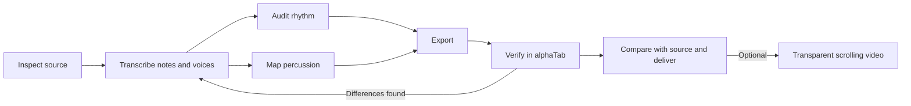

# Guitar Pro Skills

[中文](README.md) | English

Modular Agent Skills for turning PDF or image-based staff notation, tablature,
and drum notation into editable, playable, verifiable **Guitar Pro** files.

The collection covers source inspection, transcription, rhythm correction,
percussion, guitar arrangement, export, final verification, and transparent
scrolling score videos. Load only the skills needed for the task. **alphaTab is the
default verifier**, with optional TuxGuitar compatibility checks when required.

These are reusable procedures and focused utilities. Difficult scans, custom
fonts, and performance techniques still require visual interpretation. This
repository does not promise accurate, one-click conversion of arbitrary PDFs.

## Skills

| Skill | Responsibility | Main output |
| --- | --- | --- |
| [score-source-inspect](skills/score-source-inspect/SKILL.md) | Vector, raster, or mixed PDF; systems, fonts, legends | Inventory, source locations, extraction plan |
| [score-transcribe](skills/score-transcribe/SKILL.md) | Pitches, fingering, voices, repeats, ties, techniques | Source-linked intermediate records |
| [score-rhythm-audit](skills/score-rhythm-audit/SKILL.md) | Meter, tuplets, voice alignment, related errors | Timing report and source-reviewed corrections |
| [score-percussion](skills/score-percussion/SKILL.md) | Drum identities, ties, missing or silent drums | Drum map, GPIF audit and optional patch |
| [score-arrange](skills/score-arrange/SKILL.md) | Whole-bar lead priority or agreed gap filling, with source-track preservation | Derived part, per-bar provenance, change ledger |
| [score-export](skills/score-export/SKILL.md) | Format choice, preservation, import round trips | Exported scores and loss ledger |
| [score-verify](skills/score-verify/SKILL.md) | alphaTab structure, rendering, playback, source checks | Layered evidence, preview, delivery manifest |
| [score-video](skills/score-video/SKILL.md) | Render a selected GP track with proportional beat spacing and transparent BPM-driven scrolling | Alpha MOV, timeline and encode report |

Guitar Pro is the product name. `.gp` and `.gp5` identify different format
generations; changing the extension does not convert them. MusicXML and MIDI
can accompany a delivery, but MIDI does not preserve full notation or fingering.
See [score-export](skills/score-export/SKILL.md) for format decisions.

## Use with an agent

```sh
git clone https://github.com/elfgzp/guitar-pro-skills.git
cd guitar-pro-skills
```

**Tools supporting Agent Skills:** install the entire desired `skills/<name>/`
directory into your tool's supported skills location. Keep its references,
scripts, and dependency manifests together. Each skill can be copied separately;
cross-skill handoffs are optional.

**Other models or chat tools:** provide the relevant `SKILL.md` as task
instructions, adding linked references as needed. Run the utilities when Python
or Node.js is available. A visual-only agent can follow the procedure while
reporting which checks remain unperformed. No vendor API, MCP server, particular
system prompt, or operating system is required.

Example request:

> Read score-source-inspect and inspect this full band score. Retain all tracks
> and list uncertainties. Use the other skills as needed to deliver Guitar Pro
> files. Verify with alphaTab, and report TuxGuitar compatibility separately if
> required.

For an existing score, start directly with the relevant skill: rhythm problems,
silent drums, arrangement of existing lead/rhythm guitars, or final verification
do not require restarting the whole workflow.

Arrangement policy follows the intended performance. With **whole-bar lead
priority**, any lead note (including dead notes, ties and grace notes) selects the
entire lead bar and its rests. Use rhythm only when that lead bar has no notes.
Filling rests inside a lead phrase is a different policy. Check every selected
bar against its source, preserve the existing band parts, and verify cross-bar
ties/slides and the target player's actual mute state.

## Executable utilities

Run these commands from the repository root. The tested runtimes are Python
3.11+ and Node.js 20+. Install only the dependencies you need. All input/output
paths are supplied by the caller.

### PDF inspection

```sh
python -m venv .venv
# Activate using your OS's convention; on POSIX: . .venv/bin/activate
python -m pip install -r skills/score-source-inspect/requirements.txt
python skills/score-source-inspect/scripts/inspect_pdf.py input/score.pdf --output output/pdf-report.json
```

The output is an object/layout inventory. Character counts alone cannot establish
that musical symbols are directly extractable.

### Exact rational rhythm checks

```sh
python skills/score-rhythm-audit/scripts/audit_rhythm.py examples/rhythm-triplet.json --output output/rhythm-report.json
```

The [timing format](skills/score-rhythm-audit/references/rhythm-json.md) represents
each voice independently. The checker finds gaps, overlaps, and duration
mismatches; `--reference` compares independently reviewed timing. It never
stretches a faulty measure to make its sum fit.

### alphaTab verification and original synthetic example

```sh
npm --prefix skills/score-verify ci
node skills/score-verify/scripts/make_demo.cjs output/demo.gp
node skills/score-verify/scripts/audit_alphatab.cjs output/demo.gp --json output/alphatab-report.json
node --test tests/test_alphatab.cjs
```

The demo is a short, original test score generated by code. Structural and MIDI
event checks are separate from listening and comparison with the source.

To detect missing slides, independently inventory their types and per-note
endpoints from the source, then compare the exported file:

```sh
node skills/score-verify/scripts/audit_alphatab.cjs output/score.gp --expected-slides input/source-slides.json --json output/slide-report.json
```

See the [slide reference format](skills/score-verify/references/slides.md). The
checker finds missing/extra slides and wrong endpoints in the declared reviewed
ranges, including bar boundaries, dead-note origins, grace notes and explicit
string identity. Reports also inventory existing slides without a reference.
Do not generate expected slides from the tested GP file: that cannot detect marks
omitted during transcription. See [reading slides](skills/score-transcribe/references/slides.md)
for source interpretation and a complete technique inventory.

For the local browser viewer:

```sh
python -m http.server 8765 --bind 127.0.0.1
```

Open `http://127.0.0.1:8765/skills/score-verify/scripts/viewer.html` and select a
local score. Run the server only in a trusted local directory. The viewer uses
alphaTab installed inside the skill. See [score-verify](skills/score-verify/SKILL.md)
for rendering and playback instructions.

The optional GPIF percussion auditor/patcher is documented in
[score-percussion](skills/score-percussion/SKILL.md). It handles confirmed format
compatibility problems; it cannot reconstruct notes missing from transcription.

### Transparent scrolling score video

`score-video` combines alphaTab proportional horizontal notation, a complete tempo
map, Pillow frame composition, and FFmpeg encoding to create a silent
ProRes 4444 MOV with alpha. The notation scrolls beneath a fixed playhead, starting
at the first score beat with no default title card or count-in. No iMovie, other
video editor, player GUI or screen recording is required.

Every quarter note occupies a fixed pixel distance. Camera speed is
`pixels per quarter * BPM / 60`, so dense notes, sustained notes and meter changes
do not change speed at constant BPM. Actual tempo events still take effect,
including changes inside a held note. Ordinary engraving allocates width by
notation density and cannot support uniform tempo-driven scrolling without
relayout. Regenerate older tiles rather than changing only the camera speed.

Install the skill's Node/Python dependencies, Playwright browser and FFmpeg as
explained in [score-video](skills/score-video/SKILL.md), then run from the repository
root:

```sh
node skills/score-video/scripts/render_score.cjs --input input/score.gp --track 0 --output output/tiles --pixels-per-quarter 120
python skills/score-video/scripts/encode_overlay.py output/tiles/manifest.json output/overlay.mov
python skills/score-video/scripts/verify_overlay.py output/overlay.mov output/tiles/manifest.json
```

Track indices are zero-based. Defaults are 120 pixels per quarter note,
`--scale 1.6`, 1920 pixels wide and 60 FPS; height comes from the rendered notation.
Temporal spacing and glyph size are independent; frame composition preserves
subpixel movement and transparent edges. See [video formats and checks](skills/score-video/references/video-formats.md)
for scope. Single-note BeforeBeat graces borrowing 120 ticks from the previous beat
are supported, including borrowing across a barline; widen constant spacing when
fret numbers collide. Unsupported repeat/jump, swing, other grace or multiple-voice timelines must
fail explicitly instead of using a fixed bar duration. Validate decoded alpha;
a green-screen MP4 is only an optional editor-compatibility derivative. Combining
with a live performance also requires start alignment and checks for tempo drift.

Each delivery includes a localized usage guide beside the videos, filled with
the actual filenames, audio states, timing origin and sync landmarks. The
[English output template](skills/score-video/assets/usage-guide.en.md) covers
transparent overlays and optional iMovie green/blue-screen use. Editor-specific
instructions apply only when relevant; generating the assets needs no editor.

## Workflow and acceptance



Inventory every requested track and measure before dividing a band score into
sections. Preserve source pages, regions, and correction evidence throughout.
See [the workflow](docs/workflow.md) for handoff artifacts.

Record separate outcomes for **parsing, structure, rendering, playback, source
comparison, and target compatibility**. Correct bar totals do not prove correct
tuplets. Drum notes do not prove correct kit sounds or audible output. Passing
spot checks does not imply complete note-by-note review.

## Development and tests

```sh
python -m pip install -r requirements-dev.txt
npm --prefix skills/score-verify ci
python -m unittest discover -s tests -p 'test_*.py'
node --test tests/test_alphatab.cjs
npm --prefix skills/score-video ci
npm --prefix skills/score-video test
python -m unittest discover -s skills/score-video/tests -p 'test_*.py'
python tools/check_repository.py
```

Tests target reusable failure modes observed during transcription: same-column
rests and notes, fractional timing, meter changes and pickups, articulation
indices confused with MIDI pitches, missing slides, incorrect endpoints, grace
slides, round trips, and appropriately scoped
verification claims. See [testing boundaries](docs/testing.md). CI runs the same
checks.

## Portability and license

- Standard `SKILL.md` with YAML metadata; skill bodies are in English, with both
  Chinese and English READMEs.
- Parameterized scripts, relative resources, and JSON reports; no personal
  directories, account-specific runtime dependencies, or song-specific rules.
- No commercial score pages, user PDFs, full songs, fonts, sound banks, or
  third-party source code are bundled. Package managers install dependencies.
  Synthetic examples are original test data.
- Original code and documentation are [MIT licensed](LICENSE). Third-party
  dependencies, trademarks, and input scores retain their respective rights.
  This project is not affiliated with Arobas Music.

References: [Agent Skills](https://agentskills.io/specification),
[Guitar Pro](https://www.guitar-pro.com/),
[alphaTab](https://www.alphatab.net/docs/introduction), and
[PyGuitarPro](https://pyguitarpro.readthedocs.io/en/stable/).
