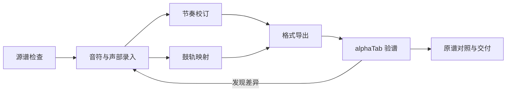

# Guitar Pro Skills

中文 | [English](README.en.md)

把 PDF／图片中的五线谱、六线谱与鼓谱，整理成可编辑、可播放、可核对的 **Guitar Pro** 谱文件的模块化 Agent Skills。

覆盖源谱检查、识谱录入、节奏校订、鼓轨处理、格式导出和最终验谱。每个 skill 独立描述输入、操作和交付证据；按需加载，不需要一次读完全部内容。默认用 **alphaTab** 验谱，按交付需要增加 TuxGuitar 兼容检查。

这是一套可复用的工作方法和小工具。复杂扫描件、特殊字体和演奏技法仍需要模型或人工识别；本仓库没有声称可以把任意 PDF 一键准确转换为 Guitar Pro。

## Skills

| Skill | 负责什么 | 主要产物 |
| --- | --- | --- |
| [score-source-inspect](skills/score-source-inspect/SKILL.md) | 判断矢量／扫描／混合 PDF，识别谱表、字体和图例 | 页清单、源谱定位、提取策略 |
| [score-transcribe](skills/score-transcribe/SKILL.md) | 录入音高、弦品、声部、反复、延音和技法 | 带原谱依据的中间记录 |
| [score-rhythm-audit](skills/score-rhythm-audit/SKILL.md) | 检查拍号、三连音、跨声部对齐与相似错误 | 节奏报告、经原谱核对的修正 |
| [score-percussion](skills/score-percussion/SKILL.md) | 识别鼓件、处理鼓延音、诊断空轨或无声 | 鼓件映射、GPIF 审计与可选补丁 |
| [score-export](skills/score-export/SKILL.md) | 选择 `.gp`／`.gp5` 等格式，保留信息并回读 | 导出文件、格式损失记录 |
| [score-verify](skills/score-verify/SKILL.md) | 用 alphaTab 检查结构、渲染和播放，再比对原谱 | 分层验证报告、预览与交付清单 |

Guitar Pro 是产品正式名称；`.gp` 与 `.gp5` 是不同代际的文件格式，不是修改扩展名就能互换。MusicXML 与 MIDI 可作为辅助交付，MIDI 不保存完整谱面和指法。格式选择见 [score-export](skills/score-export/SKILL.md)。

## 使用方式

```sh
git clone https://github.com/elfgzp/guitar-pro-skills.git
cd guitar-pro-skills
```

**支持 Agent Skills 的工具：** 将需要的 `skills/<名称>/` 整个目录安装到该工具支持的 skills 目录。保留其 `references/`、`scripts/` 和依赖清单；不同产品的安装位置由该产品决定。每个 skill 可以单独复制，跨 skill 的交接是可选的。

**其他模型／聊天工具：** 提供相关 `SKILL.md` 作为任务说明，按需附上它链接的参考文件。能执行 Python 或 Node.js 时调用小工具；只有视觉能力时按相同步骤检查并记录未完成项。无需特定厂商 API、MCP、系统提示词或操作系统。

例如：

> 请读取 `score-source-inspect`，检查这份乐队总谱。保留所有轨道，列出不确定项。随后按需要使用其余 skills，输出 Guitar Pro 文件。用 alphaTab 验谱；如需 TuxGuitar 兼容，请另列兼容检查结果。

已有谱文件的问题可以直接进入相应 skill：节奏不齐用 `score-rhythm-audit`，鼓没声音用 `score-percussion`，最终交付用 `score-verify`。

## 可执行工具

以下命令在仓库根目录运行。Python 3.11+、Node.js 20+ 是本仓库验证的运行环境；只安装当前需要的依赖。路径均由调用者指定。

### 检查 PDF

```sh
python -m venv .venv
# 激活方式依操作系统选择：POSIX 为 . .venv/bin/activate
python -m pip install -r skills/score-source-inspect/requirements.txt
python skills/score-source-inspect/scripts/inspect_pdf.py input/score.pdf --output output/pdf-report.json
```

报告是版面与对象清单，不能单凭字符数量认定音乐符号可直接提取。

### 检查准确分数表示的节奏

```sh
python skills/score-rhythm-audit/scripts/audit_rhythm.py examples/rhythm-triplet.json --output output/rhythm-report.json
```

输入格式见 [rhythm-json.md](skills/score-rhythm-audit/references/rhythm-json.md)。工具逐声部检查间隙、重叠和小节长度，可通过 `--reference` 比较独立校订的节奏。不会把不齐的小节自动拉伸到满拍。

### alphaTab 验谱与原创新谱例

```sh
npm --prefix skills/score-verify ci
node skills/score-verify/scripts/make_demo.cjs output/demo.gp
node skills/score-verify/scripts/audit_alphatab.cjs output/demo.gp --json output/alphatab-report.json
node --test tests/test_alphatab.cjs
```

演示文件由代码生成，只含人工构造的短谱例。CLI 的结构检查与 MIDI 事件检查不能代替听音或对照原谱。

本地浏览器预览：

```sh
python -m http.server 8765 --bind 127.0.0.1
```

打开 `http://127.0.0.1:8765/skills/score-verify/scripts/viewer.html`，选择本地谱文件。服务应只在可信本地目录运行；预览依赖安装在该 skill 内的 alphaTab。具体显示与播放步骤见 [score-verify](skills/score-verify/SKILL.md)。

鼓轨 GPIF 审计、可选补丁和支持范围见 [score-percussion](skills/score-percussion/SKILL.md)。补丁只处理经过确认的格式兼容问题；不能补出原谱中尚未识别的音符。

## 完整流程与验收



处理完整乐队总谱时，先建立全部轨道与小节清单，再分段录入；始终保留原谱页码、区域和修订依据。流程细节与交接产物见 [工作流](docs/workflow.md)。

验收分开记录：**格式可读取、结构正确、渲染正常、播放合理、原谱核对、目标软件兼容**。全部小节时值相加正确，不代表三连音正确；鼓轨有音符，不代表输出了正确鼓件或能听见声音；局部抽查通过，不代表全曲逐音校订完成。

## 开发与测试

```sh
python -m pip install -r requirements-dev.txt
npm --prefix skills/score-verify ci
python -m unittest discover -s tests -p 'test_*.py'
node --test tests/test_alphatab.cjs
python tools/check_repository.py
```

测试覆盖原始问题对应的通用失败模式：同列休止与音符、分数节奏、变拍与弱起、鼓件索引与 MIDI 音高混淆、格式回读和验证结论的范围。实际覆盖边界见 [测试说明](docs/testing.md)。CI 运行相同的检查。

## 可移植性与许可

- skill 使用标准 `SKILL.md` + YAML 元信息，正文用英文提高跨模型复用性；README 提供中英两版。
- 脚本使用参数、相对资源路径和 JSON 报告，不绑定个人目录、账户或某一首曲目。
- 未包含原始商业谱面、用户 PDF、完整曲谱、字体、音色库或第三方源码。依赖通过包管理器安装；演示谱例为本仓库原创测试数据。
- 本仓库原创代码与文档采用 [MIT](LICENSE)。第三方依赖、Guitar Pro 商标及输入乐谱的权利分别归其权利人；本项目与 Arobas Music 无隶属关系。

参考：[Agent Skills 规范](https://agentskills.io/specification)、[Guitar Pro](https://www.guitar-pro.com/)、[alphaTab](https://www.alphatab.net/docs/introduction)、[PyGuitarPro](https://pyguitarpro.readthedocs.io/en/stable/)。
